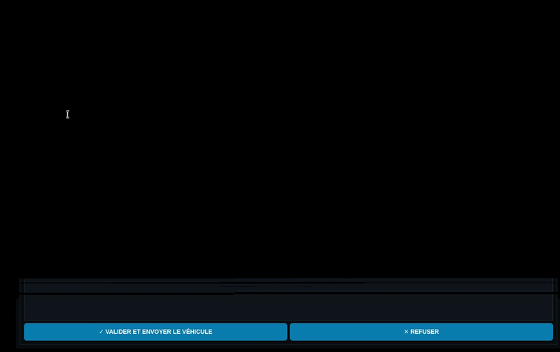
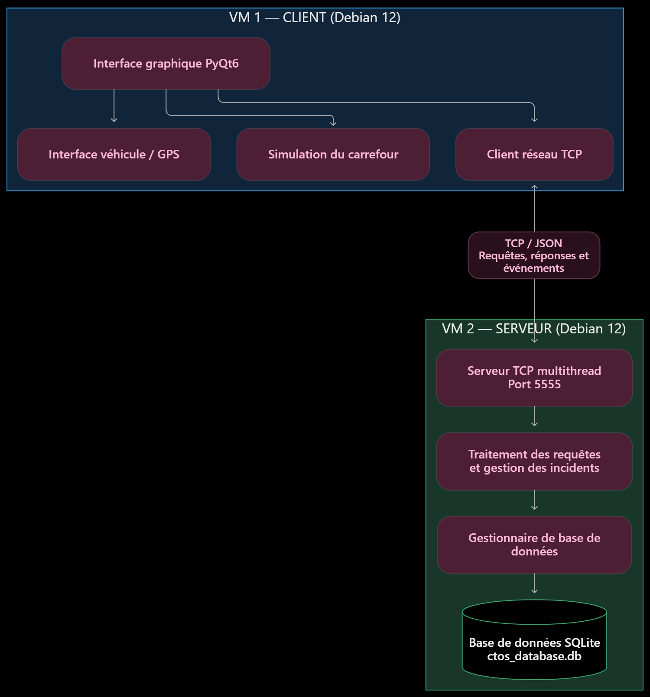

 <div align="center">


# ctOS — Centralized Traffic Operating System

**Plateforme de supervision et de gestion centralisée des incidents routiers**

Une architecture client-serveur répartie sur deux machines virtuelles Debian 12.


[Présentation](#présentation) · [Fonctionnalités](#fonctionnalités) · [Installation](#installation) · [Technologies](#technologies) · [Licence](#licence)

</div>

---

## C'est quoi le ctOS ?

ctOS est une application de supervision permettant de centraliser la gestion des incidents et des opérations liées à un environnement de circulation routière.

Le système repose sur une architecture client-serveur : le serveur centralise les données et les traitements, tandis que le client fournit une interface graphique native permettant à l'opérateur de piloter l'ensemble du système.

## Aperçu



## Présentation

ctOS a pour objectif de proposer une plateforme centralisée de supervision et de gestion des incidents.

L'opérateur dispose d'une interface principale depuis laquelle il peut :

- Consulter les incidents enregistrés.
- Déclarer un nouvel incident.
- Consulter les données stockées sur le serveur.
- Accéder aux différentes interfaces de simulation.
- Superviser les interactions entre les véhicules et le système central.

L'ensemble des données est centralisé sur la machine serveur. Le client ne possède pas de base de données locale.

## Fonctionnalités

| Fonctionnalité | Description |
|---|---|
| Console opérateur | Interface principale de gestion |
| Gestion des incidents | Création et consultation des incidents |
| Base de données | Consultation des données centralisées |
| Interface véhicule | Simulation et interactions des véhicules |
| Supervision carrefour | Visualisation de l'environnement routier |
| Communication réseau | Échanges entre le client et le serveur |
| Déploiement automatisé | Installation des dépendances par scripts Bash |

## Architecture



## Installation

### Prérequis

Avant de commencer, assurez-vous de disposer des éléments suivants :

- 2 VM Linux Debian ( de préférence sous Debian 12 ) :
- 1 vm client et 1 vm serveur


- Les configurer de cette façon dans VirtualBox :
- 


   

Les deux machines doivent pouvoir communiquer sur le réseau. Le port TCP `5555` doit être accessible depuis le client.

### 1. Installation du serveur

Copier le dossier `vm_serveur` sur la VM serveur.

Ouvrir un terminal et exécuter :

```bash
cd vm_serveur

chmod +x install.sh

./install.sh
```

Le script installe les dépendances nécessaires à l'exécution du serveur.

Une fois l'installation terminée, démarrer le serveur :

```bash
python3 server.py
```

Le serveur écoute sur le port TCP `5555`.

### 2. Installation du client

Copier le dossier `vm_client` sur la VM client.

Ouvrir un terminal et exécuter :

```bash
cd vm_client

chmod +x install.sh

./install.sh
```

Le script d'installation :

- Installe les dépendances graphiques nécessaires.
- Demande l'adresse IP de la VM serveur.
- Configure la connexion réseau.
- Prépare le lancement de l'interface ctOS.

Lorsque l'adresse IP du serveur est demandée, saisir son adresse IPv4.

### 3. Démarrage

Lancer d'abord le serveur sur la première VM :

```bash
python3 server.py
```

Puis démarrer l'interface ctOS sur la VM client selon le lanceur fourni par le projet.

Le client se connecte alors au serveur pour accéder aux données et aux fonctionnalités centralisées.

---

## Technologies

Les technologies utilisées dans le projet :

| Technologie | Utilisation |
|---|---|
| Python 3 | Développement de l'application |
| PyQt6 | Interfaces graphiques natives |
| SQLite | Stockage centralisé des données |
| TCP/IP | Communication client-serveur |
| JSON | Format d'échange des requêtes |
| Bash | Automatisation du déploiement |
| Debian 12 | Environnement d'exécution |
| VirtualBox | Environnement de virtualisation |

## Dépendances

Les dépendances sont installées automatiquement par les scripts `install.sh`.

Le projet utilise notamment :

- PyQt6 pour les interfaces graphiques.
- Qt WebEngine pour les composants graphiques web utilisés dans l'application.
- SQLite pour la gestion de la base de données.
- Les bibliothèques Python nécessaires à la communication réseau.

Les dépendances exactes et leurs versions sont définies dans les fichiers d'installation du projet.

## Structure du dépôt

```text
SAE_3.02_carrefour/
│
├── README.md
│
├── docs/
│   └── assets/
│       ├── CtOS_1.jpg
│       └── screenshots/
│           ├── console.png
│           ├── incidents.png
│           ├── carrefour.png
│           └── vehicule.png
│
├── vm_client/
│   ├── install.sh
│   ├── scripts/
│   └── ui/
│
└── vm_serveur/
    ├── install.sh
    ├── server.py
    ├── requirements.txt
    ├── bdd/
    │   └── ctos_database.db
    └── reseau/
```

*Cette arborescence est indicative : elle doit être synchronisée avec les fichiers réellement présents dans le dépôt.*

## Configuration réseau

Le client et le serveur doivent être configurés sur un réseau permettant leur communication.

Exemple de configuration :

| Machine | Adresse IP | Rôle |
|---|---|---|
| VM Serveur | 10.0.2.15 | Serveur TCP |
| VM Client | Adresse du réseau client | Interface opérateur |

Port utilisé :

```text
TCP : 5555
```

Pour tester la connectivité :

```bash
ping ADRESSE_IP_SERVEUR
```

Pour vérifier que le port est accessible depuis le client :

```bash
nc -vz ADRESSE_IP_SERVEUR 5555
```

## Dépannage

| Problème | Vérification |
|---|---|
| Serveur injoignable | Vérifier l'adresse IP et le port 5555 |
| Connexion refusée | Vérifier que `server.py` est lancé |
| Ping impossible | Vérifier la configuration réseau des VM |
| Interface graphique inaccessible | Vérifier les dépendances Qt |
| Base de données inaccessible | Vérifier les droits et le chemin de la base SQLite |

---

## Licence

La licence du projet ctOS reste à définir.

Les bibliothèques et outils tiers conservent leurs licences respectives. Avant publication, consulter leurs licences et les éventuelles obligations de redistribution.

## Crédits

Projet réalisé dans le cadre du BUT Réseaux & Télécommunications.

**Projet : SAE 3.02 — Déploiement et supervision ctOS**

Développement : équipe projet ctOS.

---

<div align="center">

**ctOS — Centralized Traffic Operating System**

*Centraliser. Superviser. Intervenir.*

</div>
