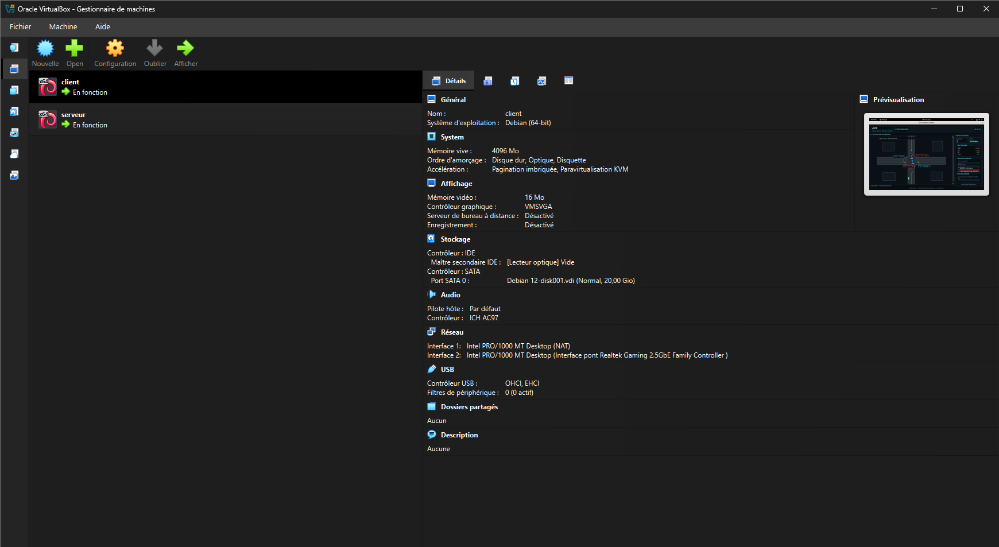
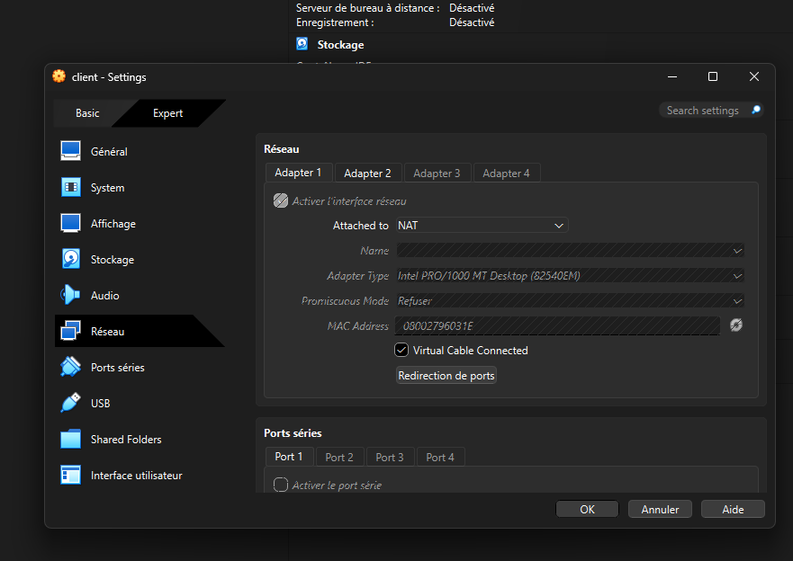
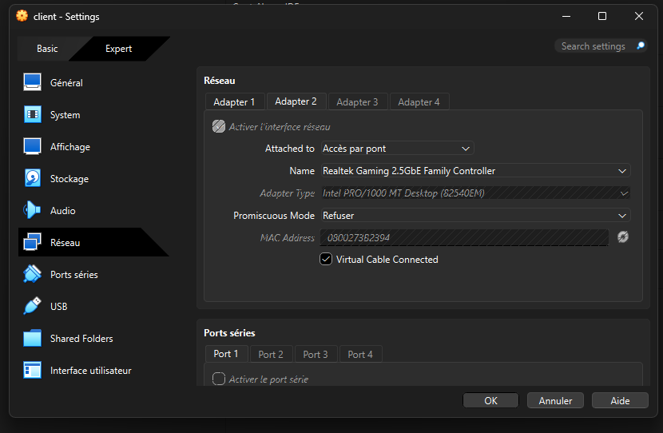

 <div align="center">


# ctOS — Centralized Traffic Operating System

**Plateforme centralisée de supervision et de gestion des incidents routiers**

Une architecture client-serveur répartie sur deux machines virtuelles Debian 12.


[Présentation](#présentation) · [Fonctionnalités](#fonctionnalités) · [Architecture](#architecture) · [Installation](#installation) · [Technologies](#technologies) · [Licence](#licence)

</div>

---

## Qu'est-ce que ctOS ?

ctOS (*Centralized Traffic Operating System*) est une application de supervision conçue pour centraliser la gestion des incidents et des opérations liées à un environnement de circulation routière.

Le système repose sur une architecture client-serveur répartie sur deux machines virtuelles Debian 12 :

- **Le serveur** centralise les données, traite les requêtes et gère les incidents.
- **Le client** fournit une interface graphique native permettant à l'opérateur de superviser et de piloter le système.

Cette organisation permet de séparer les traitements et le stockage des données de l'interface utilisateur.

## Aperçu


## Présentation

ctOS met à disposition de l'opérateur une interface centralisée permettant de superviser les différentes opérations du système.

Depuis cette interface, il est notamment possible de :

- Consulter les incidents enregistrés.
- Déclarer de nouveaux incidents.
- Consulter les données stockées sur le serveur.
- Accéder aux différentes interfaces de simulation.
- Superviser les interactions entre les véhicules et le système central.

L'ensemble des données est centralisé sur la machine serveur. Le client ne possède pas de base de données locale.

## Fonctionnalités

| Fonctionnalité | Description |
|---|---|
| Console opérateur | Interface principale de supervision et de gestion |
| Gestion des incidents | Création et consultation des incidents routiers |
| Base de données | Consultation des données centralisées sur le serveur |
| Interface véhicule | Simulation et suivi des interactions des véhicules |
| Supervision du carrefour | Visualisation et pilotage de l'environnement routier |
| Communication réseau | Échanges entre le client et le serveur via TCP/IP |
| Déploiement automatisé | Installation des dépendances à l'aide de scripts Bash |

## Architecture

ctOS utilise une architecture distribuée composée de deux machines virtuelles :

- **VM Client :** interface graphique PyQt6, simulation du carrefour et interface véhicule.
- **VM Serveur :** serveur TCP multithread, traitement des requêtes et gestion centralisée des données.
- **Communication :** échanges de messages au format JSON via TCP, sur le port `5555`.


---

## Installation

### Prérequis

Avant de commencer le déploiement, assurez-vous de disposer des éléments suivants :

- Oracle VirtualBox installé sur votre machine.
- Deux machines virtuelles Linux sous Debian 12 :
  - Une VM dédiée au serveur.
  - Une VM dédiée au client.
- Une connexion Internet sur les deux machines virtuelles.

### 1. Configuration de VirtualBox

Créez deux machines virtuelles Debian 12 : une pour le client et une pour le serveur.



Configurez ensuite les interfaces réseau de **chaque machine virtuelle** de la manière suivante :

**Adaptateur 1 : NAT**

Permet aux machines virtuelles d'accéder à Internet.



**Adaptateur 2 : Accès par pont**

Permet aux deux machines virtuelles de communiquer sur le réseau local.



> **Important :** cette configuration doit être appliquée aux deux machines virtuelles.

### 2. Préparation des machines virtuelles

Une fois les deux machines virtuelles démarrées, ouvrez un terminal sur chacune d'elles.

Passez en administrateur et installez `sudo` :

```bash
su
apt update
apt install sudo -y
exit
```

Ajoutez ensuite l'utilisateur `toto` au groupe `sudo` :

```bash
su -
usermod -aG sudo toto
```

Déconnectez-vous puis reconnectez-vous à la session `toto` afin que les nouveaux droits soient pris en compte.

> **Important :** effectuez ces opérations sur les deux machines virtuelles.

### 3. Configuration réseau

Les deux machines virtuelles doivent disposer d'une connexion Internet et pouvoir communiquer entre elles.

Pour vérifier leur connectivité, récupérez leurs adresses IP :

```bash
ip a
```

Vous pouvez ensuite tester la communication entre les deux machines :

```bash
ping ADRESSE_IP_DE_L_AUTRE_VM
```

Si une interface réseau ne reçoit pas automatiquement d'adresse IP, vous pouvez la configurer en DHCP.

Ouvrez le fichier de configuration réseau :

```bash
su
nano /etc/network/interfaces
```

Ajoutez ou adaptez la configuration suivante en remplaçant `nom_interface` par le nom réel de votre interface réseau :

```bash
# Configuration de l'interface réseau en DHCP
auto nom_interface
iface nom_interface inet dhcp
```

Enregistrez le fichier avec `Ctrl + O`, validez avec `Entrée`, puis quittez avec `Ctrl + X`.

Redémarrez le service réseau :

```bash
systemctl restart networking
```

Vérifiez ensuite l'attribution de l'adresse IP :

```bash
ip a
```

> Cette configuration est uniquement nécessaire si l'interface ne dispose pas déjà d'une adresse IP valide.

### 4. Installation du projet

Téléchargez l'archive ZIP du projet sur les deux machines virtuelles, puis extrayez-la.

Ouvrez un terminal et accédez au dossier correspondant à votre machine.

#### Installation sur la VM Serveur

Placez-vous dans le dossier `vm_serveur` :

```bash
cd vm_serveur
```

Lancez le script d'installation :

```bash
sudo bash install.sh
```

Une fois l'installation terminée, démarrez le serveur :

```bash
cd '/home/toto/Downloads/SAE_3.02_carrefour--main (1)/SAE_3.02_carrefour--main/vm_serveur' && python3 server.py
```

Le serveur est alors prêt à recevoir les connexions du client.

#### Installation sur la VM Client

Placez-vous dans le dossier `vm_client` :

```bash
cd vm_client
```

Lancez le script d'installation :

```bash
sudo bash install.sh
```

Pendant l'installation, renseignez **l'adresse IP de la VM Serveur**. Pour la récupérer, exécutez `ip a` sur la machine serveur.

Une fois l'installation terminée, lancez l'application :

```bash
cd '/home/toto/Downloads/SAE_3.02_carrefour--main (1)/SAE_3.02_carrefour--main/vm_client' && QTWEBENGINE_CHROMIUM_FLAGS="--disable-gpu --no-sandbox" QT_QPA_PLATFORM=xcb python3 client.py
```

L'interface graphique ctOS devrait alors se lancer et communiquer avec le serveur.

---

## Technologies

Le projet s'appuie sur plusieurs technologies complémentaires :

| Technologie | Utilisation |
|---|---|
| Python 3 | Développement de l'application |
| PyQt6 | Création des interfaces graphiques natives |
| Qt WebEngine | Intégration de composants web dans l'application |
| SQLite | Stockage centralisé des données |
| TCP/IP | Communication entre le client et le serveur |
| JSON | Format d'échange des messages réseau |
| Bash | Automatisation de l'installation et du déploiement |
| Debian 12 | Environnement d'exécution |
| VirtualBox | Virtualisation des machines |

## Dépendances

Les dépendances nécessaires au fonctionnement du projet sont installées automatiquement par les scripts `install.sh`.

Le projet utilise notamment :

- **PyQt6** pour les interfaces graphiques.
- **Qt WebEngine** pour les composants web intégrés.
- **SQLite** pour la gestion de la base de données.
- Les bibliothèques Python nécessaires à la communication réseau.

Les dépendances exactes sont définies dans les fichiers `requirements.txt` et les scripts d'installation.

## Crédits

Projet réalisé dans le cadre du **BUT Réseaux & Télécommunications**.

**Projet : SAE 3.02 — Déploiement et supervision ctOS**

**Équipe de développement : Seii**

Développement : Ayoub et Amaury.

<div align="center">


---

**ctOS — Centralized Traffic Operating System**

*Centraliser. Superviser. Intervenir.*

</div>
